# Telegram Ingestion Engine | B2B SI & Mention Discovery

🇬🇧 [English](README.md) | 🇷🇺 [Русский](README.ru.md) | 🇩🇪 **Deutsch** | 🇫🇷 [Français](README.fr.md) | 🇨🇳 [简体中文](README.zh-CN.md)

> **Hinweis zur Implementierung:** Trotz der gewünschten SI-Positionierung enthält dieses Repository derzeit einen Telegram-Freelance-Lead-Bot sowie eine PostgreSQL-basierte Pipeline zur Quellenermittlung und Datenerfassung. Es ist keine allgemeine Plattform zur Marken-Sentimentüberwachung. Diese README beschreibt die vorhandene Implementierung, nicht eine geplante Zielarchitektur.

Die Anwendung erfasst Beiträge aus vom Betreiber freigegebenen Telegram-Quellen, speichert sie mit dauerhaften Verarbeitungsaufträgen, filtert und analysiert optional mögliche Freelance-Aufträge und kann geeignete Treffer über einen Telegram-Bot zustellen. Quellensuche und Audit sind explizite Betreiberfunktionen, kein dauerhaft laufender Crawler.

## Architektur

```mermaid
flowchart LR
    Operator["Vom Betreiber freigegebene Quellen"] --> Collector["Telethon-Benutzer-Collector"]
    Discovery["Optionale, begrenzte Quellensuche"] --> Audit["Quellenaudit und Freigabe"]
    Audit --> Catalog["PostgreSQL-Quellenkatalog"]
    Catalog --> Collector
    Collector --> Governor["PostgreSQL-basierte Anfragesteuerung"]
    Governor --> Raw["PostgreSQL-Rohnachrichten<br/>eindeutiger Quelle/Nachricht-Schlüssel"]
    Raw --> Jobs["Dauerhafte PostgreSQL-Aufträge"]
    Jobs --> Prefilter["Deterministische Vorfilterung und Deduplizierung"]
    Prefilter --> Analyzer["Optionale Auftragsanalyse mit BYOK"]
    Analyzer --> Opportunities["Kanonische Opportunities"]
    Opportunities --> Matching["Profilabgleich und Berechtigungsprüfung"]
    Matching --> Delivery["Zustellung über Telegram-Bot"]
```



PostgreSQL speichert den Quellenkatalog, Rohnachrichten, dauerhafte Aufträge, den Zustand der Anfragesteuerung sowie Abgleichs- und Zustellungsdaten. Redis, FastAPI und Pyrogram gehören nicht zur aktuellen Architektur. Docker Compose stellt PostgreSQL und optional SearXNG lokal bereit; die Anwendung selbst wird dadurch nicht containerisiert.

## Technische Schwerpunkte

- **Kontrollierter Quellenlebenszyklus:** Kandidaten werden mit Herkunft gespeichert, auf Collector-Zugriff geprüft, anhand begrenzter Evidenz auditiert und vor Aufnahme in den Laufzeitkatalog ausdrücklich freigegeben.
- **Telegram-Anfragesteuerung:** Telethon-Operationen werden über ein PostgreSQL-basiertes Gate pro Collector-Konto getaktet und koordiniert. FloodWait-Zustände werden gespeichert; der ursprüngliche Telethon-Fehler wird weitergegeben.
- **Dauerhafte asynchrone Verarbeitung:** Nachrichten und Folgeaufgaben verwenden PostgreSQL-Aufträge mit Leases, Wiederholungen und Rückgewinnung abgelaufener Leases.
- **Idempotente Erfassung:** Ein eindeutiger Datenbankschlüssel verhindert doppelte Quelle/Nachricht-Datensätze; die spätere Vorfilterung führt exakte Duplikate durch einen persistierten Deduplizierungsprozess.
- **Optionale Analyse mit Kostenkontrollen:** BYOK, providerneutral und nur nach expliziter Konfiguration aktiv.
- **Explizite Betriebsmodi:** Ohne Argumente wird Hilfe ausgegeben und beendet. Erfassung, Quellensuche und Zustellung benötigen einen expliziten Modus und Konfiguration.

## Datenschutz, Compliance und verantwortungsvolle Nutzung

Die Software ist für eine rechtmäßige, vom Betreiber kontrollierte Überwachung autorisierter Quellen vorgesehen. Begrenzen Sie den Quellenkatalog und beachten Sie Plattformbedingungen, Datenschutzanforderungen und Aufbewahrungsrichtlinien. Öffentliche Sichtbarkeit allein begründet keine Rechtsgrundlage für Erhebung oder Verarbeitung.

Die Implementierung **garantiert keine deterministische Entfernung personenbezogener Daten vor Datenbankablage oder optionaler Analyse**:

- Telegram-Nachrichteninhalte werden für die Verarbeitungspipeline in PostgreSQL gespeichert.
- Ist ein Analyzer konfiguriert und aktiviert, können relevante Nachrichteninhalte an diesen Anbieter gesendet werden. Prüfen Sie vor Aktivierung dessen Datenverarbeitungsbedingungen.
- Strukturierte Logs schwärzen Nachrichteninhaltsfelder und konfigurierte Geheimnisse. Log-Schwärzung ist keine Bereinigung gespeicherter Nachrichten.
- Quellenlebenszyklus und Zugriffskontrollen ersetzen weder Rechtsprüfung noch Aufbewahrungsrichtlinie oder Betreiberautorisierung.

Das Projekt darf nicht zum Erfassen privater Korrespondenz, zum unbefugten Zugriff auf eingeschränkte Quellen oder für unerwünschte Massenansprache verwendet werden. Halten Sie Telegram-Sitzungen und API-Zugangsdaten aus Git heraus, beschränken Sie den Datenbankzugriff und beginnen Sie mit einer kleinen freigegebenen Quellenmenge. Siehe [SECURITY.md](SECURITY.md) und [docs/KNOWN_LIMITATIONS.md](docs/KNOWN_LIMITATIONS.md).

## Technologie und Einrichtung

- Python 3.14.7, `asyncio`; Telethon
- PostgreSQL 18, SQLAlchemy asyncio, psycopg, Alembic
- Optional: SearXNG/Webanbieter sowie OpenAI-kompatible Analyseanbieter (BYOK)
- Docker Compose für lokale PostgreSQL- und optionale SearXNG-Dienste
- Voraussetzungen und genaue Betriebs-/Testbefehle: [englische README](README.md)

Schnellstart:

```bash
uv python install 3.14.7
uv sync --locked
docker compose up -d postgres
uv run --frozen alembic upgrade head
uv run --frozen python -m freelancer_bot --check-config
```

Konfigurieren Sie `.env` lokal und committen Sie diese Datei nicht. Das Schema muss vor dem Start über Alembic migriert werden. Der Aufruf ohne Argumente ist sicher und führt keine Verbindung zu externen Diensten aus. Für den ersten Betrieb `SEND_CATCH_UP=false` und `SOURCE_DISCOVERY_ENABLED=false` beibehalten.

## Grenzen, Maintainer und Lizenz

Dieses Repository ist eine technische Grundlage, kein gehosteter Komplettdienst und keine Garantie für Produktionsqualität. Ergebnisse hängen von Quellenverfügbarkeit und -freigabe, Kontoberechtigungen, Konfiguration, externen Anbietern und Matching-Regeln ab. Telegram-Zustellung und PostgreSQL-Status lassen sich nicht atomar gemeinsam committen; bei bestimmten Fehlern ist daher eine Zustellung mindestens einmal möglich. Details: [docs/KNOWN_LIMITATIONS.md](docs/KNOWN_LIMITATIONS.md).

Lizenz: MIT, siehe [LICENSE](LICENSE).
