# Telegram Ingestion Engine | B2B SI & découverte de mentions

🇬🇧 [English](README.md) | 🇷🇺 [Русский](README.ru.md) | 🇩🇪 [Deutsch](README.de.md) | 🇫🇷 **Français** | 🇨🇳 [简体中文](README.zh-CN.md)

> **Note sur l’implémentation :** malgré le positionnement SI souhaité, ce dépôt contient actuellement un bot Telegram de détection de missions freelance et un pipeline de découverte de sources et d’ingestion adossé à PostgreSQL. Ce n’est pas une plateforme généraliste de veille du sentiment de marque. Ce README décrit l’implémentation vérifiée, et non une architecture envisagée.

L’application collecte les publications de sources Telegram approuvées par l’opérateur, les stocke avec des tâches de traitement durables, filtre et analyse éventuellement les missions freelance potentielles, puis peut transmettre les résultats éligibles via un bot Telegram. La découverte et l’audit des sources sont des opérations explicites de l’opérateur, pas un crawler toujours actif.

## Architecture

```mermaid
flowchart LR
    Operator["Sources approuvées par l’opérateur"] --> Collector["Collecteur utilisateur Telethon"]
    Discovery["Découverte de sources optionnelle et limitée"] --> Audit["Audit et approbation du cycle de vie"]
    Audit --> Catalog["Catalogue PostgreSQL"]
    Catalog --> Collector
    Collector --> Governor["Régulation des requêtes sur PostgreSQL"]
    Governor --> Raw["Messages bruts PostgreSQL<br/>clé source/message unique"]
    Raw --> Jobs["Tâches durables PostgreSQL"]
    Jobs --> Prefilter["Préfiltrage et déduplication déterministes"]
    Prefilter --> Analyzer["Analyseur de missions BYOK facultatif"]
    Analyzer --> Opportunities["Missions canoniques"]
    Opportunities --> Matching["Correspondance de profil et contrôle d’éligibilité"]
    Matching --> Delivery["Envoi par bot Telegram"]
```



PostgreSQL gère le catalogue de sources, les messages bruts, les tâches durables, l’état de régulation des requêtes ainsi que les données de correspondance et de livraison. Redis, FastAPI et Pyrogram ne font pas partie de l’architecture actuelle. Docker Compose fournit PostgreSQL local et SearXNG en option ; l’application n’y est pas conteneurisée.

## Points forts techniques

- **Cycle de vie contrôlé des sources :** les candidats sont enregistrés avec leur provenance, leur accessibilité est vérifiée, ils passent un audit à preuves bornées puis une approbation explicite avant leur activation.
- **Régulation Telegram :** les opérations Telethon sont temporisées et coordonnées par compte collecteur via PostgreSQL. L’état FloodWait est persisté et l’erreur Telethon d’origine est propagée.
- **Traitement asynchrone durable :** les messages et tâches ultérieures utilisent des tâches PostgreSQL avec leases, tentatives et récupération des leases expirés.
- **Ingestion idempotente :** une contrainte d’unicité empêche les doublons source/message ; le préfiltrage effectue ensuite une déduplication exacte persistée.
- **Analyse facultative et maîtrise des coûts :** BYOK, indépendante du fournisseur et activée uniquement par configuration explicite.
- **Modes explicites :** sans argument, l’application affiche l’aide puis quitte. La collecte, la découverte et la livraison exigent un mode et une configuration explicites.

## Confidentialité, conformité et usage responsable

Le logiciel est destiné à la surveillance légale et contrôlée par l’opérateur de sources auxquelles celui-ci est autorisé à accéder. Limitez le catalogue et respectez les conditions des plateformes, les exigences de confidentialité et les règles de conservation applicables. Le caractère public d’une source ne constitue pas, à lui seul, une base juridique de collecte ou de traitement.

L’implémentation **ne garantit pas la suppression déterministe des données personnelles avant leur stockage en base ou leur analyse facultative** :

- Le contenu brut des messages Telegram est stocké dans PostgreSQL pour le pipeline de traitement.
- Si un analyseur est configuré et activé, le contenu pertinent peut être transmis à son fournisseur. Vérifiez ses conditions de traitement avant activation.
- Les journaux structurés masquent les champs de contenu et les secrets configurés. Le masquage des journaux ne nettoie pas les messages stockés.
- Le cycle de vie des sources et les contrôles d’accès ne remplacent ni une analyse juridique, ni une politique de conservation, ni l’autorisation de l’opérateur.

N’utilisez pas ce projet pour collecter des conversations privées, accéder sans autorisation à des sources restreintes ou envoyer des sollicitations massives non demandées. Gardez les sessions Telegram et les secrets API hors de Git, restreignez l’accès à la base et commencez avec un petit ensemble de sources approuvées. Voir [SECURITY.md](SECURITY.md) et [docs/KNOWN_LIMITATIONS.md](docs/KNOWN_LIMITATIONS.md).

## Technologie et démarrage

- Python 3.14.7, `asyncio` et Telethon
- PostgreSQL 18, SQLAlchemy asyncio, psycopg et Alembic
- En option : SearXNG/fournisseurs Web et analyseurs compatibles OpenAI (BYOK)
- Docker Compose pour PostgreSQL local et SearXNG optionnel
- Prérequis et commandes détaillées de fonctionnement et de test : [README en anglais](README.md)

```bash
uv python install 3.14.7
uv sync --locked
docker compose up -d postgres
uv run --frozen alembic upgrade head
uv run --frozen python -m freelancer_bot --check-config
```

Configurez `.env` localement sans la committer. Appliquez les migrations Alembic avant de lancer l’application. L’exécution sans argument est sûre et ne se connecte pas aux services externes. Pour le premier démarrage, gardez `SEND_CATCH_UP=false` et `SOURCE_DISCOVERY_ENABLED=false`.

## Limites et licence

Ce dépôt est une base d’ingénierie, pas un service hébergé prêt à l’emploi ni une garantie de qualité de production. Les résultats dépendent de la disponibilité et de l’approbation des sources, des autorisations du compte, de la configuration, des fournisseurs externes et des règles de correspondance. L’envoi Telegram et l’état PostgreSQL ne peuvent pas être validés dans une même transaction atomique ; certains échecs peuvent entraîner une livraison au moins une fois. Voir [docs/KNOWN_LIMITATIONS.md](docs/KNOWN_LIMITATIONS.md).

Licence MIT : [LICENSE](LICENSE).
