# Telegram Ingestion Engine | B2B SI & Mention Discovery

[](https://www.python.org/)
[](https://docs.telethon.dev/)
[](https://www.postgresql.org/)
[](https://docs.python.org/3/library/asyncio.html)
[](https://docs.docker.com/compose/)

🇬🇧 **English** | 🇷🇺 [Русский](README.ru.md) | 🇩🇪 [Deutsch](README.de.md) | 🇫🇷 [Français](README.fr.md) | 🇨🇳 [简体中文](README.zh-CN.md)

> **Implementation note:** Despite the requested SI-oriented positioning, this repository currently implements a Telegram freelance-lead bot and a PostgreSQL-backed source-discovery and ingestion pipeline. It is not a general-purpose brand-sentiment monitoring platform. This README describes the checked-in implementation rather than planned or aspirational architecture.

The application collects posts from operator-approved Telegram sources, stores them with durable processing jobs, filters and optionally analyzes potential freelance opportunities, and can deliver eligible matches through a Telegram bot. Source discovery and audit are explicit operator capabilities; they are not an always-on crawler.

## Architecture

```mermaid
flowchart LR
    Operator["Operator-approved sources"] --> Collector["Telethon user collector"]
    Discovery["Optional bounded source discovery"] --> Audit["Source audit & lifecycle approval"]
    Audit --> Catalog["PostgreSQL source catalog"]
    Catalog --> Collector
    Collector --> Governor["PostgreSQL-backed request governor"]
    Governor --> Raw["PostgreSQL raw messages<br/>unique source/message key"]
    Raw --> Jobs["Durable PostgreSQL jobs"]
    Jobs --> Prefilter["Deterministic prefilter & dedup"]
    Prefilter --> Analyzer["Optional BYOK opportunity analyzer"]
    Analyzer --> Opportunities["Canonical Opportunities"]
    Opportunities --> Matching["Profile matching & entitlement checks"]
    Matching --> Delivery["Telegram bot delivery"]
```



The runtime uses PostgreSQL for the source catalog, raw-message persistence, durable jobs, request-governor state, matching, and delivery records. Redis, FastAPI, and Pyrogram are not part of the current application architecture. Docker Compose provides local PostgreSQL and optional SearXNG services; it does not containerize the application.

## Engineering highlights

- **Controlled source lifecycle:** candidates are persisted with provenance, checked for collector access, audited against bounded evidence requirements, and explicitly approved before entering the runtime catalog.
- **Telegram request governance:** Telethon operations are paced and coordinated through a PostgreSQL-backed per-collector gate. FloodWait state is persisted, and the original Telethon error is surfaced.
- **Durable asynchronous processing:** raw-message and downstream work use PostgreSQL-backed durable jobs with leases, retries, and stale-lease reclamation.
- **Idempotent ingestion and exact-content handling:** database uniqueness prevents duplicate source/message records; later prefiltering routes exact duplicates through a persisted deduplication flow.
- **Optional analysis with cost controls:** AI is bring-your-own-key (BYOK), provider-neutral, budget guarded, and disabled or unavailable unless explicitly configured.
- **Explicit operational modes:** the default command prints help and exits; collection, discovery, and delivery require explicit modes and configuration.

## Privacy, compliance & responsible use

This software is intended for lawful, operator-controlled monitoring of sources the operator is authorized to access. Configure a bounded source catalog and follow applicable platform terms, privacy requirements, and retention policies. Public visibility alone does not establish a legal basis for collection or processing.

The implementation does **not** guarantee deterministic PII removal before database storage or before optional analysis:

- Raw Telegram message content is stored in PostgreSQL for the processing pipeline.
- If an analyzer is configured and enabled, relevant message content may be sent to that provider; review the provider and data-handling terms before enabling it.
- Structured observability redacts message-content fields and configured secrets from logs. Log redaction is not the same as sanitizing stored messages.
- Source lifecycle controls and access checks do not replace a legal review, a retention policy, or operator authorization.

Do not use this project to collect private correspondence, access restricted sources without permission, or conduct unsolicited mass outreach. Keep Telegram sessions and API credentials out of Git, restrict database access, and test with a small approved source set before enabling live collection. See [SECURITY.md](SECURITY.md) and [docs/KNOWN_LIMITATIONS.md](docs/KNOWN_LIMITATIONS.md).

## Technology

- **Language/runtime:** Python 3.14.7, `asyncio`
- **Telegram:** Telethon user and bot clients
- **Persistence and jobs:** PostgreSQL 18, SQLAlchemy asyncio, psycopg, Alembic
- **Optional discovery:** SearXNG and configured web providers
- **Optional analysis:** configured OpenAI-compatible providers, BYOK
- **Local dependencies:** Docker Compose for PostgreSQL and optional SearXNG

## Requirements

- Python 3.14.7 (pinned in `.python-version`)
- uv 0.12.2 (pinned in `pyproject.toml` and CI)
- PostgreSQL 18.x
- Telegram API credentials; a user session for collection
- A Telegram bot token for bot UI or delivery
- Provider credentials only for explicitly enabled optional features

## Quick start

```bash
uv python install 3.14.7
uv sync --locked
cp .env.example .env
docker compose up -d postgres
uv run --frozen alembic upgrade head
uv run --frozen python -m freelancer_bot.persistence.source_seed --sources-json config/sources.json
uv run --frozen python -m freelancer_bot --check-config
```

Set local values in `.env`; never commit it. Use separate Telethon session paths for each process/account. The application does not create or alter the PostgreSQL schema at startup; apply migrations first. `DATABASE_URL` must use the `postgresql+psycopg://` scheme.

## Runtime modes

The no-argument command is safe and non-operational:

```bash
uv run --frozen python -m freelancer_bot
```

It prints help and exits without connecting to Telegram, PostgreSQL, or external providers. Start a specific mode only after reviewing the source catalog and configuration:

```bash
# Bot UI only; does not start the user collector or ingestion workers.
uv run --frozen python -m freelancer_bot --bot-only

# Authenticated user collector and source-discovery runtime.
uv run --frozen python -m freelancer_bot --collector-only

# Full collector, durable pipeline, matching, and delivery runtime.
uv run --frozen python -m freelancer_bot --run
```

For an initial setup, keep `SEND_CATCH_UP=false` and `SOURCE_DISCOVERY_ENABLED=false`. Consult [docs/COST_SAFETY.md](docs/COST_SAFETY.md) before enabling provider-backed work.

## Operator commands

These commands inspect and administer the PostgreSQL-backed source and processing pipeline:

```bash
# Source catalog and audit records
uv run --frozen python -m freelancer_bot.operator_cli sources list --limit 100
uv run --frozen python -m freelancer_bot.operator_cli sources audits --limit 100

# Explicit source lifecycle transition with actor and reason
uv run --frozen python -m freelancer_bot.operator_cli sources transition \
  --source-id 123 --target paused --actor operator --reason "manual review"

# Discovery, source audit, matching, and delivery inspection
uv run --frozen python -m freelancer_bot.operator_cli discovery runs --limit 100
uv run --frozen python -m freelancer_bot.operator_cli audit list --limit 100
uv run --frozen python -m freelancer_bot.operator_cli match runs --limit 100
uv run --frozen python -m freelancer_bot.operator_cli delivery list --limit 100
```

Discovery and audit do not bypass the source lifecycle or automatically approve candidates. Review [docs/COST_SAFETY.md](docs/COST_SAFETY.md) before running provider-backed discovery or analysis.

## Tests and checks

```bash
uv sync --locked
uv run --frozen python -m unittest discover -s tests
uv run --frozen python -m py_compile freelancer_bot/*.py freelancer_bot/persistence/*.py migrations/*.py migrations/versions/*.py
uv run --frozen alembic check
```

PostgreSQL integration tests require `TEST_DATABASE_URL`; tests use fakes for Telegram and external providers. Do not run live collection or provider-backed commands as part of routine CI.

## Known limitations

This repository is an engineering baseline, not a hosted turnkey service or a production-quality guarantee. Live results depend on source availability and approval, account permissions, configuration, optional provider availability, and matching/entitlement rules. Telegram delivery and PostgreSQL state cannot be committed atomically, so external delivery is at-least-once across certain failure windows. Review [docs/KNOWN_LIMITATIONS.md](docs/KNOWN_LIMITATIONS.md) before deployment.

## License

MIT. See [LICENSE](LICENSE).
