# Telegram Ingestion Engine | B2B SI и поиск упоминаний

🇬🇧 [English](README.md) | 🇷🇺 **Русский** | 🇩🇪 [Deutsch](README.de.md) | 🇫🇷 [Français](README.fr.md) | 🇨🇳 [简体中文](README.zh-CN.md)

> **Примечание о реализации:** несмотря на желаемое позиционирование для SI, в репозитории сейчас реализованы Telegram-бот для поиска заказов фрилансерам и конвейер обнаружения источников и сбора данных на PostgreSQL. Это не универсальная платформа мониторинга тональности брендов. Документация описывает проверенную реализацию, а не планируемую архитектуру.

Приложение получает публикации из одобренных оператором источников Telegram, сохраняет их вместе с устойчивыми заданиями обработки, фильтрует и при явной настройке анализирует возможные заказы, а подходящие результаты может отправлять через Telegram-бота. Обнаружение и аудит источников запускаются оператором и не являются постоянно работающим скрейпером.

## Архитектура

```mermaid
flowchart LR
    Operator["Одобренные оператором источники"] --> Collector["Сборщик Telethon"]
    Discovery["Опциональный ограниченный поиск источников"] --> Audit["Аудит и утверждение источника"]
    Audit --> Catalog["Каталог источников PostgreSQL"]
    Catalog --> Collector
    Collector --> Governor["Управление запросами на PostgreSQL"]
    Governor --> Raw["Сырые сообщения PostgreSQL<br/>уникальный ключ источник/сообщение"]
    Raw --> Jobs["Устойчивые задания PostgreSQL"]
    Jobs --> Prefilter["Детерминированная фильтрация и дедупликация"]
    Prefilter --> Analyzer["Опциональный анализ заказов с BYOK"]
    Analyzer --> Opportunities["Канонические заказы"]
    Opportunities --> Matching["Сопоставление профиля и проверка права доступа"]
    Matching --> Delivery["Доставка Telegram-ботом"]
```



PostgreSQL используется для каталога источников, исходных сообщений, устойчивых заданий, состояния управления запросами, сопоставления и записей доставки. Redis, FastAPI и Pyrogram не входят в текущую архитектуру. Docker Compose запускает локальный PostgreSQL и опциональный SearXNG; приложение в Compose не контейнеризовано.

## Инженерные особенности

- **Контролируемый жизненный цикл источника:** кандидаты сохраняются с происхождением, проверяются на доступность коллектору, проходят аудит с ограниченным объёмом данных и явно утверждаются до добавления в рабочий каталог.
- **Управление запросами Telegram:** операции Telethon регулируются и координируются через шлюз на PostgreSQL для каждого аккаунта-коллектора. Состояние FloodWait сохраняется, исходная ошибка Telethon передаётся вызывающему коду.
- **Устойчивая асинхронная обработка:** сообщения и последующие задачи обрабатываются через задания PostgreSQL с арендой, повторами и восстановлением просроченной аренды.
- **Идемпотентный сбор и точная дедупликация:** уникальность в БД предотвращает повторную запись одной пары «источник/сообщение»; последующая фильтрация направляет точные дубликаты по сохраняемому процессу дедупликации.
- **Опциональный анализ с контролем расходов:** анализатор использует ключ оператора (BYOK), не привязан к одному провайдеру и включается только явной конфигурацией.
- **Явные режимы работы:** запуск без аргументов выводит справку и завершает работу; сбор, поиск источников и доставка требуют явного режима и настройки.

## Конфиденциальность, соответствие требованиям и ответственное использование

ПО предназначено для законного мониторинга источников, к которым оператор имеет право доступа. Ограничивайте каталог источников и соблюдайте применимые условия платформы, требования конфиденциальности и правила хранения. Публичная доступность сама по себе не означает наличия правового основания для сбора и обработки.

Реализация **не гарантирует детерминированное удаление персональных данных до записи в БД или передачи на анализ**:

- Исходное содержимое сообщений Telegram сохраняется в PostgreSQL для конвейера обработки.
- Если настроен и включён анализатор, соответствующее содержимое сообщений может отправляться провайдеру; до включения проверьте условия провайдера и обработки данных.
- Структурированное логирование скрывает поля с содержимым сообщений и настроенные секреты. Сокрытие в логах не означает очистку сохранённых сообщений.
- Жизненный цикл источников и проверки доступа не заменяют юридическую оценку, политику хранения или разрешение оператора.

Не используйте проект для сбора личной переписки, доступа к закрытым источникам без разрешения или массовых нежелательных рассылок. Не храните Telegram-сессии и API-секреты в Git, ограничьте доступ к БД и начинайте с небольшого набора одобренных источников. Подробности: [SECURITY.md](SECURITY.md) и [docs/KNOWN_LIMITATIONS.md](docs/KNOWN_LIMITATIONS.md).

## Технологии

- Python 3.14.7, `asyncio`
- Telethon: пользовательские и бот-клиенты Telegram
- PostgreSQL 18, SQLAlchemy asyncio, psycopg, Alembic
- Опциональное обнаружение источников: SearXNG и настроенные веб-провайдеры
- Опциональный анализ: настроенные OpenAI-совместимые провайдеры, BYOK
- Docker Compose для PostgreSQL и опционального SearXNG

## Требования и запуск

- Python 3.14.7 (версия зафиксирована в `.python-version`)
- uv 0.12.2
- PostgreSQL 18.x
- API-данные Telegram; пользовательская сессия для сбора
- Токен Telegram-бота для интерфейса или доставки
- Данные провайдера нужны только для включённых опциональных функций

```powershell
uv python install 3.14.7
uv sync --locked
cp .env.example .env
docker compose up -d postgres
uv run --frozen alembic upgrade head
uv run --frozen python -m freelancer_bot.persistence.source_seed --sources-json config/sources.json
uv run --frozen python -m freelancer_bot --check-config
```

Заполните `.env` локально и не коммитьте его. Используйте отдельные пути Telethon-сессий для каждого процесса и аккаунта. Схема PostgreSQL не создаётся и не меняется при запуске приложения: сначала примените миграции. Для `DATABASE_URL` требуется схема `postgresql+psycopg://`.

Запуск без аргументов безопасен и только выводит справку. Для явного запуска используйте одну из команд:

```bash
uv run --frozen python -m freelancer_bot --bot-only
uv run --frozen python -m freelancer_bot --collector-only
uv run --frozen python -m freelancer_bot --run
```

Для первоначальной настройки оставьте `SEND_CATCH_UP=false` и `SOURCE_DISCOVERY_ENABLED=false`. Описание режимов, проверок и тестов приведено в [английском README](README.md).

## Ограничения и лицензия

Это инженерная основа, а не готовый облачный сервис или гарантия качества промышленной эксплуатации. Результаты зависят от доступности и утверждения источников, прав аккаунта, конфигурации, внешних провайдеров и правил сопоставления. Доставка в Telegram и запись состояния в PostgreSQL не являются одной атомарной транзакцией, поэтому при некоторых сбоях возможна доставка «как минимум один раз». См. [docs/KNOWN_LIMITATIONS.md](docs/KNOWN_LIMITATIONS.md).

Лицензия — MIT, см. [LICENSE](LICENSE).
