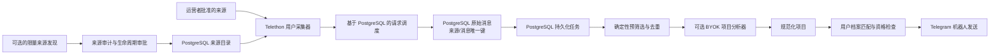

# Telegram Ingestion Engine | B2B SI 与提及发现

🇬🇧 [English](README.md) | 🇷🇺 [Русский](README.ru.md) | 🇩🇪 [Deutsch](README.de.md) | 🇫🇷 [Français](README.fr.md) | 🇨🇳 **简体中文**

> **实现说明：** 尽管目标定位涉及 SI，本仓库当前实现的是 Telegram 自由职业线索机器人，以及基于 PostgreSQL 的来源发现和数据采集流程。它不是通用的品牌情感监测平台。本 README 描述已核实的代码实现，而非规划中的目标架构。

应用从运营者批准的 Telegram 来源采集帖子，将其与持久化处理任务一同保存，对潜在自由职业项目进行筛选，并可在明确配置后进行分析；符合条件的结果可通过 Telegram 机器人发送。来源发现和审计是由运营者显式触发的功能，不是持续运行的爬虫。

## 架构



PostgreSQL 用于来源目录、原始消息、持久化任务、请求调度状态以及匹配和发送记录。当前架构不包含 Redis、FastAPI 或 Pyrogram。Docker Compose 提供本地 PostgreSQL 和可选的 SearXNG 服务；应用本身并未由 Compose 容器化。

## 工程特性

- **受控的来源生命周期：** 候选来源会连同来源信息持久化，检查采集器是否可访问，经过有界证据审计，并在明确批准后才进入运行目录。
- **Telegram 请求调度：** Telethon 操作通过 PostgreSQL 中按采集账号维护的请求门控进行节流和协调。FloodWait 状态会持久化，原始 Telethon 异常会继续向上传递。
- **持久化异步处理：** 消息及后续任务使用 PostgreSQL 持久化任务，支持租约、重试及过期租约回收。
- **幂等采集：** 数据库唯一约束防止同一来源/消息记录重复写入；后续预筛选会通过持久化流程处理精确重复内容。
- **可选分析与成本控制：** BYOK、与供应商解耦，只有在显式配置后才启用。
- **显式运行模式：** 不带参数时只显示帮助并退出；采集、来源发现和发送都需要明确指定模式和配置。

## 隐私、合规与负责任使用

本软件用于运营者在获准访问的范围内，以合法且受控的方式监测来源。请限制来源目录，并遵守适用的平台条款、隐私要求和数据保留政策。来源公开可见本身并不构成收集或处理数据的法律依据。

当前实现**不保证在写入数据库或进行可选分析之前确定性地移除个人数据**：

- 为支持处理流程，Telegram 原始消息内容会存储在 PostgreSQL 中。
- 如果配置并启用了分析器，相关消息内容可能会发送给该服务提供商；启用前请审查其数据处理条款。
- 结构化日志会隐藏消息内容字段和已配置的机密信息。日志脱敏不等于已清理数据库中的消息。
- 来源生命周期和访问控制不能替代法律审查、数据保留政策或运营者授权。

不得使用本项目采集私人通信、未经许可访问受限来源或进行未经请求的大规模外联。请勿将 Telegram 会话和 API 凭据提交到 Git，限制数据库访问，并先使用少量已批准来源进行测试。详见 [SECURITY.md](SECURITY.md) 和 [docs/KNOWN_LIMITATIONS.md](docs/KNOWN_LIMITATIONS.md)。

## 技术栈与快速启动

- Python 3.14.7、`asyncio`、Telethon
- PostgreSQL 18、SQLAlchemy asyncio、psycopg、Alembic
- 可选：SearXNG/Web 搜索服务及兼容 OpenAI 的分析服务（BYOK）
- Docker Compose 用于本地 PostgreSQL 和可选的 SearXNG
- 完整前置条件、运行模式和测试命令请参见[英文 README](README.md)

```bash
uv python install 3.14.7
uv sync --locked
docker compose up -d postgres
uv run --frozen alembic upgrade head
uv run --frozen python -m freelancer_bot --check-config
```

请在本地配置 `.env`，不要提交该文件。应用启动前必须先运行 Alembic 迁移。不带参数运行是安全的，不会连接外部服务。首次配置时保持 `SEND_CATCH_UP=false` 和 `SOURCE_DISCOVERY_ENABLED=false`。

## 已知限制与许可证

本仓库是工程基础，不是即开即用的托管服务，也不保证生产质量。结果取决于来源可用性和审批状态、账号权限、配置、外部服务以及匹配规则。Telegram 发送与 PostgreSQL 状态更新无法在同一原子事务中提交，因此部分故障场景下可能发生至少一次发送。详见 [docs/KNOWN_LIMITATIONS.md](docs/KNOWN_LIMITATIONS.md)。

许可证为 MIT，详见 [LICENSE](LICENSE)。
